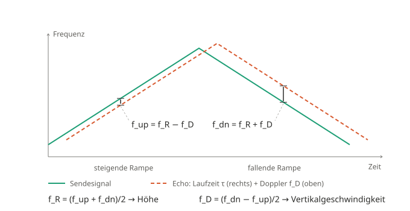
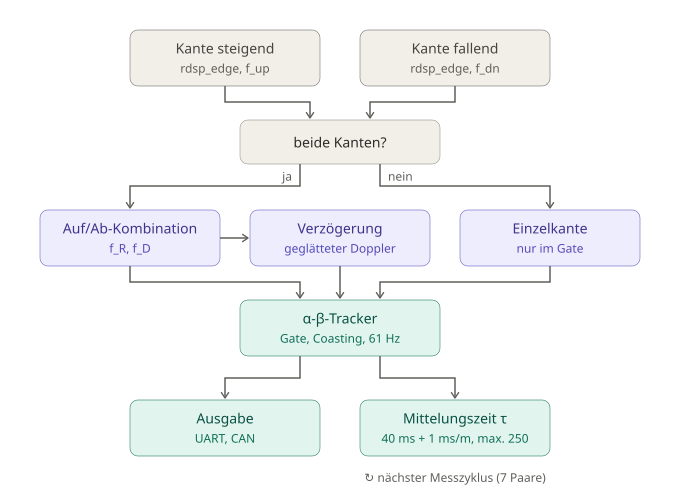

# Signalverarbeitungskette

Die Kette ist in unabhängige Module der Bibliothek `lib/rdsp` zerlegt. Jedes Modul arbeitet
auf vom Aufrufer bereitgestellten Puffern (kein `malloc`), nutzt nur `float` und ist auf dem
PC wie auf dem Cortex-M4F identisch lauffähig. Die anwendungsspezifische Verknüpfung steht in
`firmware/app/altimeter.c`. Alle Parameter liegen in `firmware/app/radar_params.h`.

## Grundlagen FMCW

Der VCO wird linear über den Hub `B` in der Zeit `T` gewobbelt (Steigung `S = B/T`).
Ein Ziel in der Entfernung `R` erzeugt im ZF-Signal einen Ton

```
f_R = 2·S·R / c0                 (Entfernungs-Beat)
f_D = 2·v_c / λ                  (Doppler, v_c = Annäherungsgeschwindigkeit, λ = 12,4 mm)
steigende Rampe:  f_up = |f_R − f_D|
fallende Rampe:   f_dn = |f_R + f_D|
```

Daraus `f_R = (f_up + f_dn)/2` (dopplerfrei) und `f_D = (f_dn − f_up)/2`. Deshalb wird eine
**Dreieckmodulation** verwendet: Bei 24 GHz erzeugen schon 1 m/s Sinkrate 161 Hz Doppler.



**Taktunabhängigkeit:** `f_R` wird in FFT-Bins gemessen (`bin·fs/N`), die Steigung ist
`S = B·fs/(L−1)`. Damit kürzt sich `fs` heraus. Die Höhe hängt nicht von der
Quarzgenauigkeit ab (wichtig für den HSI-Notbetrieb), nur die Geschwindigkeit.

## Der Boden ist kein Punktziel

Aus dem Flugzeug gesehen beleuchtet die Keule (K-LC1a: 34° × 80°) eine Fläche. Daraus folgt:

- **Entfernungsspreizung:** Das Echo beginnt bei der Senkrechten (Höhe h) und reicht bis zu
  den Rändern der Keule (bei 80° quer bis ≈ 1,3·h).
- **Doppler-Spreizung:** Mit der Fluggeschwindigkeit v_h haben Streupunkte vor und hinter
  dem Flugzeug ±2·v_h·sin θ/λ Doppler. Bei 30 m/s und ±12° (Keule) sind das ±1 kHz.
- **Speckle:** Die vielen Streupunkte überlagern sich mit zufälliger Phase, die Amplitude
  schwankt von Rampe zu Rampe.

Im Spektrum ist das Bodenecho deshalb ein **breiter Hügel**. Die Höhe ist sein **Anfang**
(Vorderkante), nicht sein Maximum. Die Verschmierung durch Doppler in Metern ist proportional
zur Rampendauer: `ΔR = f_D·c0·T/(2·B)`. Mit einer 8-ms-Rampe wäre der Hügel bei 30 m/s ±13 m
breit, mit der verwendeten 1,17-ms-Rampe etwa ±2 m.

Diese Kette wurde gegen das Bodenmodell des Simulators entwickelt (`test/sim.c`,
`sim_ground()`): 512 Streupunkte in der Keule, Empfindlichkeit nach dem Datenblatt des K-LC1a
(−114 dBc / 500 Hz, 1/f-Rauschen des Mischers, TLV9064), Fluggeschwindigkeit, Speckle.

## Wellenform und Erfassung (`bsp/frontend.c`)

| | |
|---|---|
| Rampe (Rand + Auswertung + Rand) | 48 + 256 + 48 = 352 Samples = 1,173 ms |
| Messpaare (steigend + fallend) | 426 pro Sekunde |
| FFT | 512 Punkte (256 Samples, 2× Nullauffüllung) |
| Entfernung pro FFT-Bin (90 MHz) | 1,14 m (Auflösung 2,29 m) |
| Schwebung | 513 Hz/m, 200 m ≈ 103 kHz (fs = 300 kHz) |
| Messzyklus / Ausgabe | 7 Paare = 16,4 ms (≈ 61 Hz) |

Kurze Rampen haben pro Rampe etwa dieselbe Empfindlichkeit wie lange: Die Schwebung liegt
7-mal höher, wo das 1/f-Rauschen des Mischers kleiner ist. Dafür gibt es 7-mal mehr Rampen
zum Mitteln.

Ein einziger Timer (TIM2, 300 kHz) triggert **DAC und ADC gleichzeitig**. Beide laufen per DMA
in Endlosschleifen gleicher Länge (2 × 352), Sample *i* ist damit fest an Rampenwert *i*
gekoppelt. Halb- und Voll-Interrupt markieren das Ende der steigenden bzw. fallenden Rampe.
Die ersten und letzten 48 Samples (160 µs) enthalten den Umkehrpunkt und werden verworfen.
Verstärkungswechsel werden an Rampengrenzen geschaltet, die folgende Rampe wird verworfen.

## Überblick der Verarbeitung

Jede Rampe durchläuft die Schritte 0–4, jeder Messzyklus die Schritte 5–8:




## Schritt 0 – AGC (`rdsp_agc`)

Eingang: Spitzenauslenkung relativ zum Aussteuerbereich (`peak_frac`) und Clipping.
- Zurückgeschaltet wird nach **3 übersteuerten Rampen in Folge** (`attack_frames`). Ein
  einzelner Störpuls schaltet also nicht; jeder Verstärkungswechsel startet die Mittelung neu.
- Hochgeschaltet wird nach 0,3 s mit `peak_frac < 0,2`.
- Bedingung gegen Pendeln: `lo·Stufenverhältnis < hi`.

## Schritt 1 – Frame-Aufbereitung (`rdsp_frame`)

* `uint16` → `float`, Mittelwert abziehen; Statistik: Mittelwert, RMS, Min/Max, Clipping.
* **Gesundheitsprüfung:** RMS < 0,05 LSB oder Mittelwert außerhalb 200…3895 LSB über 40
  Rampen ergibt `HW_FAULT`.
* Rampen mit mehr als 3 geclippten Samples werden nicht ausgewertet.
* Linearer Trend-Abzug (Rest der Leckage, die mit der Rampe mitläuft).

## Schritt 2 – Fensterung (`rdsp_window`)

Periodisches **Hann-Fenster** über die 256 Samples (−31 dB Nebenkeulen, 18 dB/Oktave),
danach Nullauffüllung auf 512. Die Nullauffüllung tastet die Vorderkante doppelt so fein ab;
ohne sie schwankte die Kantenlage je nach Lage im Bin um ±0,3 m.

## Schritt 3 – FFT (`rdsp_fft`)

Reelle FFT über eine komplexe FFT der Länge N/2 plus Split-Schritt (Radix-2, in place).
Ausgabeformat identisch zu CMSIS `arm_rfft_fast_f32`. Getestet gegen eine direkte DFT.

## Schritt 3a – Laufender Hintergrundabzug (`rdsp_clutter_update`)

Feste Echos relativ zum Flugzeug (Antennenübersprechen, Radom, Fahrwerk) haben von Rampe zu
Rampe dieselbe komplexe Amplitude, das Bodenecho nicht (λ/2 = 6 mm, Vorwärtsflug).

Je Bin bis `ALT_BG_MAX_M` = 25 m werden der komplexe Mittelwert M und die mittlere Leistung P
geführt. Abgezogen wird M · |M|²/P (Kohärenzgewicht):

| Echo | Kohärenz \|M\|²/P | Wirkung |
|---|---|---|
| festes Echo | ≈ 1 | verschwindet |
| bewegtes Echo | ≈ β/2 | bleibt praktisch unverändert |

- Zeitkonstante 2 s, Einlaufen über 8 Rampen. Rampen aus der Einlaufzeit gehen nicht in die
  Spektrenmittelung ein (sie enthalten das feste Echo noch).
- Eine Schätzung je Verstärkung und Rampenrichtung (≈ 6 KB), kein Neustart bei
  Verstärkungswechsel.
- Das Band reicht bis 25 m, damit die Nebenzipfel eines starken Fahrwerksechos (bei 2–5 m)
  innerhalb enden; sonst entstünde an der Bandgrenze eine künstliche Kante.
- Während der Kalibrierung ruht der Abzug.

**Grenze:** Ein Ziel unter 25 m, das relativ zum Radar ruht, wird entfernt. Am Boden stehend
ist das erwartet, für Labortests deshalb `bg off`.

## Schritt 4 – Leistungsdichte und robuste Mittelung (`rdsp_spectrum`)

`PSD[k] = c_k·|X[k]|² / (fs·s2)` (einseitig). Gemittelt wird **über aufeinanderfolgende Rampen
gleicher Richtung** (`rdsp_psd_avg_robust`):

- anfangs kumulativer Mittelwert, dann exponentiell mit der Zeitkonstante τ;
- **τ adaptiv:** 40 ms + 1 ms je Meter Höhe, höchstens 250 ms; bei schwachem Echo (unter 8 dB)
  immer 250 ms;
- ein neuer Wert wird auf das 10-fache des Mittelwerts begrenzt: Ein einzelnes starkes
  Störecho verfälscht den Mittelwert kaum, eine echte Pegeländerung wird trotzdem in einigen
  Rampen übernommen;
- Spektren verschiedener Verstärkung werden nie gemischt.

## Schritt 5 – Vorderkante (`rdsp_edge`)

Beim Höhenmesser kann nichts näher sein als der Boden. Die Bins vor der Kante enthalten also
nur Rauschen. Der Detektor schaut deshalb nur **zurück** (kürzere Entfernungen):

```
noise(b) = max( Median der 24 Bins vor b (2 Bins Abstand),
                log-linearer Trend dieses Fensters, extrapoliert auf b,
                0,7 · globales Rauschen )
Kante    = erstes b mit p[b..b+2] > thr · noise(b)
           thr = max(1,4 ; 1 + 5/sqrt(gemittelte Rampen))
Plateau  = Maximum der 12 Bins danach
Lage     = 50-%-Punkt zwischen Rauschen und Plateau, interpoliert
```

- Der **Trend** verhindert Fehlalarme, wenn die Rauschdichte mit der Frequenz steigt (Hochpässe
  im ZF-Zweig, auf Rev. B bis 106 kHz): Ein ansteigendes Rauschen sähe sonst selbst wie eine
  Vorderkante aus.
- Die **Untergrenze** verhindert dasselbe, wenn das Rauschen zu DC hin abfällt.
- Ein Hügel, der schon im untersten Bin beginnt (DC, Leckage, Nachschwingen der Hochpässe),
  hat keine verwertbare Kante und wird übersprungen; gesucht wird dahinter weiter.
- Verlangt werden außerdem 3 dB Plateau über dem Rauschen.

**Kalibrierung der Kantenlage:** Bei geringer Höhe ist der Hügel schmal (fast ein Punktziel),
sein 50-%-Punkt liegt dann 0,7 Bin vor der Mitte; bei großer Höhe ist er breit. Die Korrektur
in Abhängigkeit von der Höhe steht in `ALT_EDGE_CORR_*` (1,7 m bei 0 m bis −1,75 m bei 300 m).
Sie stammt aus dem Bodenmodell (`test/range_sim.c b`) und muss mit Flugdaten geprüft werden.

Für die **Kalibrierung** (`cal1`/`cal2`) mit einem Reflektor (Punktziel) wird stattdessen das
Maximum mit log-parabolischer Interpolation verwendet (`rdsp_peak`).

## Schritt 6 – Auf-/Ab-Kombination und Verzögerungsausgleich (`altimeter.c`)

- Beide Kanten vorhanden: `f_R = (f_up + f_dn)/2`, `f_D = (f_dn − f_up)/2`; |f_D| muss zur
  maximalen Vertikalgeschwindigkeit (25 m/s) passen. Kanten unter 4 Bins (≈ 4,6 m) gelten als
  unsicher (Status `DEGRADED`, Doppler nicht verwendet).
- Nur eine Kante: Höhe mit dem vorhergesagten Doppler (`DEGRADED`). Eine solche Messung darf
  den Track nur verfeinern: Liegt sie außerhalb des Gates, wird sie verworfen. Sie kann den
  Track also nie starten oder versetzen.
- **Verzögerung der Mittelung:** Das gemittelte Spektrum zeigt den Zustand von vor etwa
  0,69·τ. Die Höhe wird mit einer **geglätteten Doppler-Geschwindigkeit** (0,5 s) auf „jetzt“
  verschoben. Nicht mit der Tracker-Geschwindigkeit: Die entsteht aus genau diesen Messungen,
  und die Rückkopplung schaukelte sich bei schwachem Echo bis ±25 m/s auf (im Test gefunden).

## Schritt 7 – Tracking (`rdsp_track`)

α-β-Filter, ein Update pro Messzyklus (16,4 ms): α = 0,4, β = 0,01, Doppler-Geschwindigkeit
mit γ = 0,03. Bei schwachem Echo (unter 6 dB) wird statt der momentanen die geglättete
Doppler-Geschwindigkeit verwendet. Die Geschwindigkeit stammt damit fast nur aus dem Doppler:
β ist klein, weil die Positionen bei schwachem Echo um ±1 Bin springen können.

Zustände: LOST → TENTATIVE (3 Treffer) → CONFIRMED → COAST (bis 0,25 s gültig) → LOST (nach
1 s). Ausreißer außerhalb des Gates werden verworfen, 6 konsistente Messungen außerhalb
gelten als echter Sprung (Gebäudekante) und starten den Track neu.

## Genauigkeit und Reichweite (Simulator, `make -C test range`)

Siehe [hardware/rev_b_f446/README.md](../hardware/rev_b_f446/README.md#mögliche-reichweite).
Kurz: Über Wiese gültig bis 100–125 m, über Asphalt/Wasser bis 250 m. Bis 30 m/s
Fluggeschwindigkeit liegt der Fehler meist unter 1 m. **Systematische Grenze:** Die
Doppler-Spreizung zieht die Vorderkante nach vorn. Die Höhe ist bei 30 m/s um etwa 0,5 m, bei
60 m/s um 1–2 m zu klein. Korrigieren ließe sich das mit der Fluggeschwindigkeit (z. B. GPS
über CAN).

## Wiederverwendung

`lib/rdsp` hat keine Abhängigkeit zur Hardware oder zum Höhenmesser. Beispiel für ein
anderes FMCW-Projekt mit ausgedehntem Ziel:

```c
rdsp_rfft_init(&fft, NFFT, tw);               rdsp_window_make(win, NS, RDSP_WIN_HANN, &wi);
rdsp_frame_condition_u16(adc, NS, x, 8, 4087, 4095, &st);  rdsp_frame_detrend(x, NS);
rdsp_window_apply(x, win, NS);                /* x[NS..NFFT-1] = 0 */
rdsp_rfft(&fft, x);                           rdsp_clutter_update(&x[2], m, p, nb, beta, 1);
rdsp_rfft_power(x, x, NFFT);                  rdsp_psd_onesided(x, NFFT/2, fs, wi.s2);
rdsp_psd_avg_robust(avg, x, NFFT/2, alpha, 10.0f);
if (rdsp_edge_detect(&ecfg, avg, NFFT/2, 2, bmax, rdsp_median(avg, lo, hi), &e)) { f = e.pos * fs / NFFT; }
```

Für Punktziele (Abstandsmesser) stehen weiterhin OS-CFAR (`rdsp_cfar`) und die exakte
Hann-Interpolation (`rdsp_peak`) zur Verfügung.
