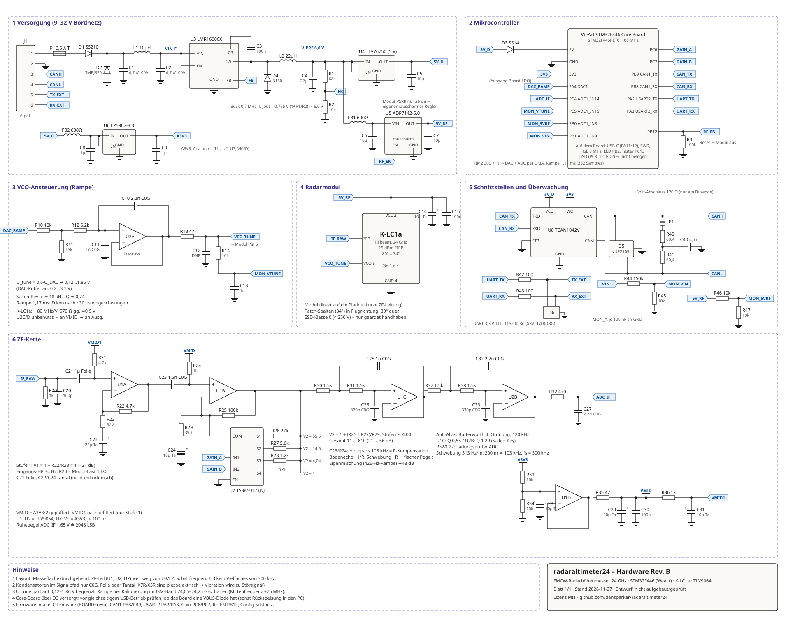

# Hardware Rev. B – STM32F446 (WeAct) + K-LC1a + TLV9064



> **Status: Entwurf, weder aufgebaut noch gemessen.** Die Pinbelegung des WeAct-Boards
> (HSE 8 MHz, LED PB2, µSD an PC8–PC12/PD2, USB an PA11/PA12) stammt aus der
> Zephyr-Boardbeschreibung und muss vor dem Layout am Board-Schaltplan geprüft werden.

## Auslegung

### VCO-Ansteuerung (Block 3)

| Punkt | Wahl | Begründung |
|---|---|---|
| Teiler R10/R11 | U_tune = 0,6 · U_DAC | Der DAC-Puffer ist aktiv (0,2…3,1 V), damit ergibt sich U_tune = 0,12…1,86 V. Damit bleibt man innerhalb der Datenblattgrenze von 2,0 V, und 12 bit lösen ≈ 0,4 mV ≈ 32 kHz auf. |
| Sallen-Key (U2A) | fc ≈ 18 kHz, Q ≈ 0,74 | Glättet die Stufen des DAC-Takts (300 kHz: −49 dB). Die Gruppenlaufzeit (≈ 13 µs) liegt weit unter dem verworfenen Rampenkopf (640 µs). |
| R13 = 47 Ω | Treiber | Der VCO-Eingang (570 Ω gegen ≈ 0,9 V intern) braucht Quelle und Senke bis 1,7 mA; das kann der TLV9064. |
| MON_VTUNE | ADC PC5 | Die Firmware kann prüfen, ob die Rampe am Modul wirklich ankommt (Unterbrechung, OPV-Defekt). |
| RF_EN | LDO-EN, Pull-down | Bei Reset ist das Modul aus und sendet nicht unkontrolliert. Außerdem lässt sich der Rauschboden bei abgeschaltetem Sender messen (Selbsttest). |

**ISM-Band:** Die Mittenfrequenz hat eine Toleranz von ±75 MHz (24,05…24,25 GHz). Die Rampe muss deshalb
per Kalibrierung so liegen, dass sie das Band nicht verlässt. Die Firmware-Vorgabe von 90 MHz Hub
entspricht etwa 1,1 V an U_tune.

### ZF-Kette (Block 6)

Die Stufen im Einzelnen:

1. **Last und Kopplung:**
   - R20 = 1 kΩ ist die Last laut Datenblatt.
   - C20 = 100 pF unterdrückt HF-Einstreuung.
   - C21 = 1 µF Folie mit R21 bildet einen Hochpass bei 34 Hz und trennt den Modul-Offset ab (10…200 mV).
2. **U1A, Vorverstärker V = 11:**
   - Der Gegenkopplungszweig ist niederohmig (470 Ω / 4,7 kΩ) und rauscht nur ≈ 2,8 nV/√Hz.
   - DC-Verstärkung 1 über C22, damit kein Offset verstärkt wird.
3. **C23/R24, Hochpass 16 kHz (Entfernungskompensation):**
   - Das Bodenecho fällt etwa mit 1/R, die Schwebungsfrequenz steigt mit R. Ein Hochpass 1. Ordnung darunter macht den Pegel über die Höhe etwa flach und spart Dynamik.
   - Zusätzlich dämpft er die Eigenmischung (Gleichanteil, der mit der VCO-Spannung wandert, also im 61-Hz-Takt der Rampe) um ≈ 48 dB.
4. **U1B + U7 (TS3A5017), Verstärkung umschaltbar 1 / 4,04 / 14,6 / 55,5:**
   - Die Stufen sind ≤ 4,25 und passen damit zur AGC der Firmware.
   - Der Schalter liegt im hochohmigen Rückkopplungszweig, sein R_on (≈ 12 Ω) geht deshalb kaum ein.
   - R25 = 100 kΩ hält die Schleife geschlossen, während umgeschaltet wird.
5. **U1C, Anti-Alias Sallen-Key fc ≈ 31 kHz,** dann R32/C27 als Ladungspuffer für den ADC (PC4).
6. **U1D, VMID = A3V3/2 gepuffert:**
   - VMID1 ist für den Eingang zusätzlich gefiltert.
   - Der Ruhepegel liegt bei 2048 LSB und passt damit zur HW-Fehlererkennung (200…3895 LSB).

Gesamtverstärkung 11…610 (21…56 dB). Bei 610 liegt das Modulrauschen (≈ 9,5 nV/√Hz bei 15 kHz) am ADC
bei ≈ 6 µV/√Hz und damit über dem ADC-Rauschen (≈ 2 µV/√Hz). Der ADC verschenkt also keine Empfindlichkeit.

**Rauschen TLV9064:**
- Der TLV9064 hat ≈ 10 nV/√Hz, das Modul bei 15 kHz ≈ 9,5 nV/√Hz. Bei großer Höhe kostet der OPV deshalb ≈ 3 dB.
- Ein rauschärmerer erster Verstärker (≤ 3 nV/√Hz, z. B. ADA4897-1) brächte ≈ 15 % mehr Reichweite.
- Der Rest kann beim TLV9064 bleiben.

**Kondensatoren im Signalpfad** nur in C0G, Folie oder Tantal. X7R/X5R sind piezoelektrisch und machen
aus Vibrationen ein Störsignal im ZF-Band.

### Versorgung (Block 1)

```
VIN 9–32 V → F1 → D1 (Verpolung) → D2 TVS → L1/C2 → U3 Buck 6,0 V ─┬→ U4 LDO 5V_D → Core-Board (D3), CAN, U6 → A3V3
                                                                   └→ FB1 → U5 ADP7142 5V_RF → Modul (EN = RF_EN)
```

- Das Modul unterdrückt Störungen auf der Versorgung nur um **26 dB**, deshalb bekommt es einen eigenen
  rauscharmen Regler.
- Der Buck läuft mit 0,7 MHz, also nicht mit einem Vielfachen von 300 kHz, und liegt räumlich weit weg von der ZF.

### Pinbelegung STM32F446

| Funktion | Pin | Bemerkung |
|---|---|---|
| DAC Rampe | PA4 (DAC1) | DMA1 Stream5 Ch7, wie F405 |
| ZF-ADC | PC4 (ADC1_IN14) | DMA2 Stream0 Ch0, wie F405 |
| MON_VTUNE / MON_5VRF / MON_VIN | PC5 / PB0 / PB1 | Injected oder langsam per Polling |
| GAIN_A / GAIN_B | PC6 / PC7 | TS3A5017 IN1/IN2 |
| RF_EN | PB12 | 100 kΩ Pull-down |
| CAN1 TX / RX | PB9 / PB8 (AF9) | PA11/PA12 belegt der USB-Anschluss |
| USART2 TX / RX | PA2 / PA3 | |

### Firmware

Build mit `make -C firmware` (Standard `BOARD=revb`, Rev. A: `BOARD=reva`).

- Gleicher Takt wie Rev. A: 168 MHz aus HSE 8 MHz (keine Over-Drive-Umschaltung nötig), TIM2 300 kHz.
- Konfiguration in Flash-Sektor 7 (0x08060000).
- Kein CCM: Alle Puffer liegen im SRAM, belegt sind 87 KB von 128 KB (inkl. 8 KB Stack).
  Möglich wurde das durch den laufenden Hintergrundabzug statt gespeicherter Hintergründe
  (56 KB → 4 KB).
- Pins wie in der Tabelle; RF_EN wird erst unmittelbar vor dem Start der Rampe gesetzt.
- DAC-Standardbereich K-LC1a: 724…3000 (U_tune 0,35…1,45 V um die Leerlauffrequenz).
- Noch offen: Selbsttest über MON_VTUNE, MON_5VRF, MON_VIN; Polarität der Board-LED PB2 prüfen.

## Mögliche Reichweite

### Grundlage aus dem Datenblatt

- Empfindlichkeit −114 dBc bei 500 Hz Bandbreite und S/N 6 dB.
- Die Reichweitenformel des Datenblatts, r = 0,0167 · 10^(−S/40) · σ^¼, gilt für Punktziele: ≈ 12 m für σ = 1 m².
- Für einen Höhenmesser ist der Boden aber ein **Flächenziel**. Die Berechnung (`range_estimate.py`, Modell unten) berücksichtigt deshalb:
  - das ausgeleuchtete Bodenstück aus der Antennenkeule 80° × 34° (Hin- und Rückweg);
  - Integration nur über die erste Entfernungszelle (1,98 m bei 90 MHz Hub, Langrampe);
  - FFT-Bin mit Hann-Fenster: 220 Hz Rauschbandbreite statt 500 Hz;
  - 1/f-Rauschen des Moduls: −134 dBm/Hz bei 500 Hz, −164 dBm/Hz bei 1 MHz. Bei 5…15 kHz Schwebung ist das 7…10 dB weniger Rauschen, und zwar inklusive TLV9064;
  - 3 dB Verluste (Radom, Exemplarstreuung, Temperatur);
  - Doppler-Verschmierung durch Horizontalgeschwindigkeit, mit der 34°-Ebene in Flugrichtung.

### Ergebnis

Maximale Höhe mit sicherer Erkennung:

| Boden (σ⁰ nahe Senkrecht) | Schwebeflug, CFAR 12 dB (heutige FW) | 40 m/s, 12 dB | Schwebeflug, 5 dB (≈ 16 Rampen gemittelt) | 40 m/s, 5 dB |
|---|---|---|---|---|
| −10 dB (Schnee, Gestrüpp) | 15 m | < 10 m | 35 m | 10 m |
| 0 dB (Wiese, Acker) | 60 m | 15 m | 120 m | 50 m |
| +10 dB (Asphalt, Wasser senkrecht) | 160 m | 80 m | 320 m | 210 m |

### Folgerungen

- **200 m sind mit dem K-LC1a nur über gut reflektierendem Boden erreichbar.** Realistisch sind ≈ 50…120 m bei normalem Gelände. Bei geringer Höhe (Landung) ist die Reserve groß, > 20 dB unter 10 m.
- **Größter Hebel in der Firmware:** Oberhalb von ≈ 50 m mehr Rampen mitteln und die Schwelle senken. Bei dieser Höhe genügen 10 Hz Ausgaberate, und das bringt etwa Faktor 2 Reichweite.
- **Fluggeschwindigkeit verschmiert das Bodenecho stark:** Bei 40 m/s und 34° Keule entstehen ±1,7 kHz Doppler, das entspricht ±23 m bei der Langrampe.
  - Gegenmaßnahmen: die schmale 34°-Ebene in Flugrichtung montieren und bei Reiseflug die steilere Kurzrampe nutzen. Dort sind es nur ±7 m.
  - **Der Simulator bildet diesen Effekt noch nicht ab.** Er sollte vor einem Einsatz ergänzt werden.
- Ein rauschärmerer erster OPV bringt ≈ +15 %. Eine schmalere Antenne oder ein Modul mit mehr Sendeleistung bringen mehr.

Die Werte sind Abschätzungen mit grober Bodenstreuung (σ⁰ schwankt real um ±10 dB). Messen statt glauben:
Die Checkliste in [`docs/inbetriebnahme.md`](../../docs/inbetriebnahme.md) gilt sinngemäß.

## Stückliste (Hauptteile)

| Ref | Teil | Funktion |
|---|---|---|
| — | WeAct STM32F446 Core Board | MCU |
| M1 | RFbeam K-LC1a (5 V, mit FM-Eingang) | Radar |
| U1, U2 | TLV9064IPWR | ZF-Kette / VCO-Treiber |
| U3 | LMR16006XDDCR | Buck 6 V, 4…60 V Eingang |
| U4 | TLV76750DCYR | LDO 5 V digital |
| U5 | ADP7142ARDZ-5.0 | LDO 5 V Radar, rauscharm |
| U6 | LP5907MFX-3.3 | LDO 3,3 V analog |
| U7 | TS3A5017PWR | Verstärkungsumschaltung |
| U8 | TCAN1042VDRQ1 | CAN mit VIO 3,3 V |
| D1 / D2 / D4 | SS210 / SMBJ33A / B160 | Verpolung / TVS / Freilauf |
| D5 / D6 | NUP2105L / PESD3V3S2UT | ESD CAN / UART |
| C21 | 1 µF Folie (PPS/PET) | ZF-Kopplung |
| C22, C24, C14, C28, C29, C31 | Tantal / Polymer | nicht mikrofonisch |
